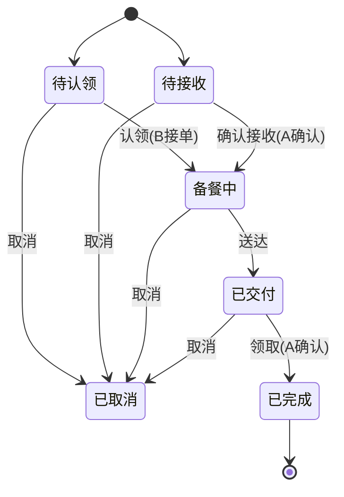

# 情侣带饭点餐小程序 · 产品需求文档（PRD）

> 版本：v0.4（需求草案）　|　日期：2026-10-26　|　状态：需求评审中

---

## 1. 产品概述

### 1.1 定位
情侣之间"约今天吃啥、谁带饭"的**私密协作小程序**。非外卖、非账本、非严肃 AA。

### 1.2 一句话价值
**不是外卖，是"我记得你爱吃什么，并且愿意为你带饭"的专属记录仪。**

### 1.3 目标用户
- 处于稳定亲密关系的情侣（固定 2 人）。
- 至少有一方有"带饭 / 做饭给对方"的行为习惯（上班族、学生情侣居多）。
- 核心痛点：每天"今天谁带 / 带啥"协商成本高；偏好靠口头重复；带饭行为没有情感留存。

### 1.4 与替代品的本质差异

| 维度 | 我们 | 外卖平台 | 情侣 / 记账 App |
|---|---|---|---|
| 关系 | 固定 2 人、私密 | 陌生商家 | 通用多人 |
| 核心 | 约定 + 偏好记忆 + 情感数据 | 交易 / 配送 | 钱 / 任务 |
| 温度 | 便签 / 仪式感 / 年报 | 无 | 弱 |
| 货币 | 虚拟爱心值（不碰钱） | 真实支付 | 真实或虚拟账 |

---

## 2. 已确认的核心决策

| 项 | 决策 |
|---|---|
| 产品形态 | 纯点餐约定（约谁带、带啥），**无严肃饭债互欠** |
| 货币 | 纯虚拟记账：轻量爱心值，正向激励，不碰真实钱，不做欠债 |
| 后端 | 自建 **Spring Boot 3.4 + MyBatis-Plus + MySQL 8**（沿用备课系统栈） |
| 前端 | 微信小程序原生 / uni-app |
| MVP 推送 | 系统内红点 / 角标；微信订阅消息放二期 |
| 菜品图片 | MVP 纯文字起步，省存储；二期支持上传 |
| 时段 | MVP 仅午饭；午 + 晚放二期 |

---

## 3. 突出点（差异化卖点）

| # | 突出点 | 我们怎么做 | 对比对象 | 为什么是壁垒 |
|---|---|---|---|---|
| **A** | 被记住的私密偏好库 | 忌口 / 爱吃自动沉淀，点餐时**主动拦截**"对方不吃这个" | 外卖每次从头选 | 情感价值：被记住；越用越懂对方 |
| **B** | 投喂养成的情感数据 | 爱心值、连续投喂、在一起吃饭天数、**年度带饭年报** | 冷冰冰订单 / 账单 | 把日常变成可回看的甜蜜记录，非账本 |
| **C** | 线下交付仪式感 | "已放公司门口柜 B12" + **便签留言**"留了汤" | 陌生人送达无温度 | 专属感：我给你送到楼下，不是快递 |
| **D** | 协商式"今天谁带" | 轮流制 / 小程序内**石头剪刀布** / 协商 | 各点各的，无机制 | 把情侣真实扯皮变成有趣机制 |
| **E** | 情感化表达替代交易语言 | "投喂""突然想吃你做的""想你" | "下单 / 支付 / 配送" | 语言即调性，区隔工具感 |

---

## 4. 信息架构

### 4.1 底部 Tab
```
Tab1 今日约定（首页）   Tab2 菜单库   Tab3 消息   （我的 / 设置入口在右上）
```

### 4.2 页面清单

| 页面 | 归属 | 说明 |
|---|---|---|
| 登录页 | 账户 | 微信授权登录 |
| 配对页 | 账户 | 未绑定时，生成 / 输入邀请码 |
| 关系主页 | 账户 | 双人头像、称呼、在一起天数、累计爱心值（嵌在 Tab1 顶部） |
| 今日约定页 | Tab1 | 今日约定卡片 + 发起入口 |
| 发起约定页 | Tab1 | 两种角色表单（点餐 / 主动带） |
| 约定详情页 | Tab1 | 状态推进、改派、改期、取消、便签 |
| 菜单库页 | Tab2 | 菜品列表、筛选、新增 |
| 菜品编辑弹层 | Tab2 | 增删改查 |
| 消息中心 | Tab3 | 通知列表、红点 |
| 历史页 | 入口 | 约定历史、统计（二期） |
| 周历视图 | Tab1 | 一周谁带可视化（协商式谁带落地） |
| 采购清单页 | Tab1 | 带饭前生成要买啥，到超市照买 |
| 设置页 | 我的 | 称呼 / 纪念日 / 主题 / 提醒 / 解绑 |

> 双人视角：同一约定，A（点餐方）与 B（带饭方）看到的按钮不同。

---

## 5. 功能需求详述

### 5.1 关系与账户
- **微信登录**：点"微信登录" → `wx.login` 拿 code → 后端换 openid → 建 / 查 user → 回 token；已登录跳过；token 过期静默刷新。
- **创建情侣（发起方）**：点"创建情侣" → 后端生成 6 位邀请码（24h 时效）→ 展示邀请码 + 二维码 → 状态"等待对方加入"。
- **加入情侣（加入方）**：输入邀请码 / 扫二维码 → 点"加入" → 双方绑定 → 双端提示进入关系主页。
- **专属称呼**：互设"宝宝 / 老板"，全站替换昵称。
- **自定义在一起纪念日**：独立于绑定日，驱动年报 / 倒计时。
- **绑定趣味问卷（初始化偏好）**："谁厨房担当？""谁更爱吃辣？"——一次填完，菜单库与口味画像直接有底。
- **情侣主题色 / 头像框**：轻量个性化。
- **解绑（二期）**：设置 → 解绑 → 二次确认 → 关系置失效；数据归属见 §10。

**边界**：邀请码过期可一键重生成；一方已绑定则阻止重复绑定（需先解绑）。

### 5.2 点餐约定（核心）　★含 A / C / D / E
- **点餐入口（A 想吃）**：Tab1 点"我想吃" → 发起页（角色=点餐方）→ 选 / 填菜品 → 选时段（午 / 晚）→ 填备注（口味 / 时间 / 地点）→ 提交 → 生成约定 `orderer=A, status=待认领` → 推提醒给 B。
- **主动带入口（B 带）**：Tab1 点"我带饭" → 发起页（角色=带饭方）→ 选 / 填菜品 → 提交 → 生成约定 `carrier=B, status=待接收` → A 需"确认接收"后才转`备餐中`（防一方单方面决定）。
- **菜单选择**：发起页"从菜单选" → 弹层（常点 / 分类 / 最近三组）→ 单选或多项带回 → 选中对方忌口项红字拦截。
- **协商式"今天谁带"★D**：三种模式——轮流制（自动排班）、协商（小程序内抛硬币 / 石头剪刀布）、指定。解决"今天你带还是我带"。
- **情感化点餐文案★E**：模板"突然想吃你做的红烧肉""今天好累，想吃你带的饭" + 自由输入，替代冷冰冰下单。
- **认领（B 接 A 的餐）**：B 在 Tab1 看到 A 的待认领约定 → 点"我来带" → `carrier=B, status=备餐中`。A 不能认领自己的点餐。
- **状态推进（带饭人）**：备餐中 → 点"已做好 / 已买" → 点"已送达" → `status=已交付`（带到达时间）。可一步直达。
- **交付仪式感★C**：标记"已放门口柜 B12 / 已到楼下" + 可选照片，接收方"下楼领取"。
- **便签留言★C**：带饭人附"锅里留了汤，趁热喝"；接收方回"爱你❤"。
- **确认完成（接收方）**：A 收到"已交付"提醒 → 点"已领取" → `status=已完成` → **触发 carrier 爱心值 +1**。
- **代投喂**：没空亲手做 → 下外卖 / 顺路买 → 标记"代投喂"，爱心照加但"亲手做"徽章不计。
- **多菜品 / 拼单**：一次约定可挂多个菜。
- **轻量履约评价**：接收方点"好吃 / 一般"，仅双方可见，优化下次（非公开评分）。
- **改派**：详情页 carrier 点"改派" → 退回待认领（或指定对方）→ 仅 carrier 可操作。
- **改期**：详情页点"改到明天" → `plan_date+1`，状态不变。
- **取消**：任一方点"取消" → 填原因 → `status=已取消`，写 `cancel_log(谁 / 何时 / 原因)` → 不发爱心值；已完成的不可取消。
- **采购清单（联动约定）★C**：带饭人认领后，基于约定菜品一键生成"要买啥"购物单（也可手填）；到超市逐项勾选"已买"；可提前一天备料。解决"带饭先买菜"的真实环节，最落地。
- **共同周历视图★D**：Tab1 内切换"今日 / 本周"，以周表展示每天谁带、带啥；协商式谁带的结果直接落在这张表上，一眼看清一周分工。

### 5.3 菜单库　★含 A
- **查看**：默认全量，区分归属（我 / 对方），可按分类（荤 / 素 / 汤 / 主食）和标记（常点★ / 忌口⚠）筛选。
- **"我记得你"自动沉淀★A**：每次点餐 / 完成自动归入对方偏好，忌口永久记住。
- **新增**：点"+" → 名称、分类、可选图片（二期）、标常点 / 忌口、选归属（我 / 对方）→ 保存。
- **忌口分级**：不吃（强提醒，仍可提交）/ 少吃（黄字提醒）/ 过敏（红字强提醒，仍可提交）。按 Q2 决策——不硬拦，仅提醒由人决定。
- **口味画像**：系统归纳"TA 这月 70% 点辣的" → 洞察卡。
- **菜谱笔记**：不只菜名，存做法"红烧肉要加冰糖"。
- **"想试试"种草清单**：未点过的，约下次。
- **双人共创**：双方都能加，归属清晰。
- **编辑 / 删除**：点编辑改；删除二次确认。
- **智能推荐（偏好出口）★A**：基于口味画像与历史，发起点餐时在菜单层顶部推"今天适合吃红烧肉（TA 本周 70% 点辣）"；把"被记住"从被动拦截升级为主动推荐。

### 5.4 爱心值（轻量正向，非欠债）　★含 B
- **俏皮命名**：投喂值 / 爱心币。
- **加分触发**：约定变`已完成` → 后端自动给 carrier `+1`（reason=带饭），按 `plan_id` 幂等。
- **累计展示**：关系主页显示总爱心值 + 各自贡献（如"你 23 / TA 19"）。
- **连续投喂打卡★B**：连续 N 天，断签提示"昨天谁鸽了？"。
- **在一起吃饭天数★B**：累计一起吃饭天数。
- **里程碑徽章**：初次投喂、满 10 / 50 / 100 顿、连续 7 天、专属厨师（某类菜带最多）。
- **不抵扣、不欠债**（区别于情感账本 App）。

### 5.5 消息与提醒
- **系统内通知（MVP）**：触发点——新约定（给被点餐方）、被认领（给点餐方）、已交付（给点餐方）、已完成（给双方）。写入通知表 → Tab3 红点 → 点开跳约定详情。
- **温馨文案★E**："该投喂 TA 啦~""TA 说想你做的饭"。
- **到达带位置提醒**：已送达时推"在楼下，下来拿"。
- **每日"今天谁带"推送（协商辅助）**。
- **微信订阅消息（二期）**：前端 `requestSubscribeMessage` + 后端模板推送，覆盖上述通知。

### 5.6 历史与统计　★含 B
- **历史列表**：按时间倒序展示全部约定（已完成 / 取消都留痕）→ 筛选日 / 周 / 月 → 点开看详情。
- **"我们的带饭年报"★B**：年度回顾——今年谁带得多、最爱菜、连续最久纪录、爱心值总结。情感化数据产品。
- **月度轻报告★B**：年报的轻量版，每月初推送上月小结（谁带多、最爱菜、爱心值变化），频次更高、更常触发情感回流。
- **最爱菜品 TOP、平均每周几顿、连续天数纪录**（二期）。

### 5.7 设置
称呼 / 纪念日 / 主题色 / 提醒开关 / 解绑 / 退出登录。

---

## 6. 核心业务流程与状态机

### 6.1 点餐约定状态机



- **待认领**：A 点餐，等 B 认领。
- **待接收**：B 主动带，等 A 确认接收。
- **任意非终态可取消**：记 `cancel_log`，不发爱心值。
- **已完成**：唯一终态，触发爱心值 +1（按 `plan_id` 幂等）。

### 6.2 协商式"今天谁带"流程（★D）
1. 进入"今天谁带" → 选模式：轮流 / 协商 / 指定。
2. 轮流：按历史自动排，本期轮到谁高亮。
3. 协商：小程序内抛硬币 / 石头剪刀布，结果双方同步。
4. 指定：任一方直接指定自己或对方。
5. 确定后，被指定方自动成为该日约定的 carrier（或发起主动带）。

### 6.3 爱心值加分时序（★B）
```
约定 status → 已完成  ──(后端钩子)──>  love_value 插入 delta=+1 (carrier, plan_id 去重)
                                       关系主页 / 统计 累加展示
```

---

## 7. 数据模型（MySQL 8）

```sql
-- 情侣关系
CREATE TABLE couple (
  id         BIGINT PRIMARY KEY,
  user_a     BIGINT NOT NULL,
  user_b     BIGINT NOT NULL,
  status     TINYINT DEFAULT 1 COMMENT '1有效 0失效',
  created_at DATETIME DEFAULT CURRENT_TIMESTAMP
);

-- 用户（微信）
CREATE TABLE user (
  id       BIGINT PRIMARY KEY,
  openid   VARCHAR(64) UNIQUE,
  nickname VARCHAR(64),
  avatar   VARCHAR(255)
);

-- 点餐约定
CREATE TABLE meal_plan (
  id          BIGINT PRIMARY KEY,
  couple_id   BIGINT NOT NULL,
  orderer_id  BIGINT NOT NULL COMMENT '点餐方',
  carrier_id  BIGINT     COMMENT '带饭方(认领/主动带后填入)',
  meal_type   TINYINT COMMENT '1午 2晚',
  title       VARCHAR(255),
  remark      VARCHAR(512) COMMENT '口味/时间/地点',
  status      TINYINT COMMENT '0待认领1待接收2备餐中3已交付4已完成5已取消',
  plan_date   DATE,
  is_proxy    TINYINT DEFAULT 0 COMMENT '代投喂标记',
  created_at  DATETIME DEFAULT CURRENT_TIMESTAMP
);

-- 菜单 / 忌口库
CREATE TABLE menu_item (
  id          BIGINT PRIMARY KEY,
  couple_id   BIGINT NOT NULL,
  name        VARCHAR(128),
  category    TINYINT COMMENT '1荤2素3汤4主食',
  is_favorite TINYINT DEFAULT 0,
  avoid_level TINYINT DEFAULT 0 COMMENT '0无1少吃2不吃3过敏',
  creator_id  BIGINT,
  note        VARCHAR(512) COMMENT '菜谱笔记'
);

-- 爱心值流水（轻量）
CREATE TABLE love_value (
  id         BIGINT PRIMARY KEY,
  couple_id  BIGINT NOT NULL,
  user_id    BIGINT NOT NULL COMMENT '获得方(carrier)',
  plan_id    BIGINT COMMENT '去重键',
  delta      INT DEFAULT 1,
  reason     VARCHAR(64),
  created_at DATETIME DEFAULT CURRENT_TIMESTAMP
);

-- 采购清单（联动约定）
CREATE TABLE shopping_list (
  id         BIGINT PRIMARY KEY,
  plan_id    BIGINT NOT NULL COMMENT '关联约定',
  couple_id  BIGINT NOT NULL,
  item_name  VARCHAR(128) COMMENT '食材/商品',
  checked    TINYINT DEFAULT 0 COMMENT '是否已买',
  created_at DATETIME DEFAULT CURRENT_TIMESTAMP
);
```

---

## 8. 非功能需求

- **双人同步**：MVP 用"进页面拉取 + 下拉刷新 + 系统内通知"保证两端看到最新，不上 WebSocket。
- **幂等**：爱心值、状态流转按 `plan_id` + 状态机校验，防重复加值 / 越级跳转。
- **数据隔离**：仅情侣双方可见彼此数据，关系外不可达。
- **推送策略**：MVP 系统内红点 / 角标；二期接入微信订阅消息（需授权 + 后端模板）。
- **存储**：MVP 菜品纯文字；图片二期，建议对象存储。

---

## 9. 已确认规则（原 Open Questions）

| # | 问题 | 决策结论 |
|---|---|---|
| Q1 | 解绑后数据归属？ | **已确认**：逻辑删除 couple，各自记录保留（双方本地历史仍可看） |
| Q2 | 忌口是否强制拦截？ | **已确认**：不硬拦，仅提醒可继续（不吃/过敏弹强提醒，仍可由人提交） |
| Q3 | MVP 时段范围？ | **已确认**：MVP 仅午饭，晚 / 加餐二期 |
| Q4 | 代投喂是否计爱心？ | **已确认**：计爱心，但不计"亲手做"徽章 |

---

## 10. MVP 范围 vs 二期

| 模块 | MVP | 二期 |
|---|---|---|
| 关系 | 登录 / 配对 / 关系主页 | 解绑 / 主题色 / 头像框 |
| 约定 | 点餐 / 主动带 / 认领 / 状态机 / 取消 / 便签 / 代投喂 | 改期 / 协商式石头剪刀布 / 轻量评价 |
| 菜单库 | 增删改查 / 常点 / 忌口拦截 / 最近点过 | 图片 / 口味画像 / 菜谱笔记 / 种草 |
| 爱心值 | 完成 +1 / 累计展示 | 连续打卡 / 徽章 / 在一起天数 |
| 消息 | 系统内通知 + 红点 | 订阅消息 / 每日提醒 |
| 历史 | 历史列表 | 统计 / 年度带饭年报 |
| 丰富功能(新增) | 采购清单 / 共同周历 / 智能推荐 / 月度报告 | 本期新增，强化突出点 A/C/D/B |

---

## 11. 技术栈与里程碑建议

**技术栈**
- 前端：微信小程序原生 / uni-app
- 后端：Spring Boot 3.4 + MyBatis-Plus + MySQL 8
- 部署：自建（你已有 MySQL 8 环境）

**建议里程碑**
1. 项目骨架（实体 / 表 / Mapper / 基础接口）
2. 约定闭环（点餐 → 认领 → 状态机 → 完成）
3. 菜单库 + 忌口拦截
4. 爱心值 + 关系主页
5. 消息中心（系统内通知）
6. 历史列表
7. 丰富功能落地：采购清单 + 共同周历 + 智能推荐 + 月度报告（强化突出点 A/C/D/B）
8. 二期：推送 / 图片 / 统计年报 / 协商式石头剪刀布

---

## 12. 开发前准备与详细设计（配套文档）

产品需求之外，另起一份 `开发前准备与详细设计.md`，覆盖：
- 开发前准备清单（账号 / 域名 HTTPS / 库表 / 脚手架 / 合规）
- 技术架构、鉴权、统一返回、API 清单草案
- 数据字典补充与索引建议
- 各模块异常与边界（状态越级 / 并发幂等 / 忌口冲突 / 跨天等）
- 安全合规、测试策略、上线审核、里程碑任务拆解

> 本文档为产品基线，配套文档为技术准备基线，两者配合对照。

---

*本文档由需求讨论沉淀，后续以本文件为开发对照基线。*

---

### 版本变更
- **v0.2（2026-10-26）**：补充 4 个强化突出点的功能 —— 采购清单（§5.2 / §7）、共同周历视图（§5.2）、智能推荐（§5.3）、月度轻报告（§5.6）；同步更新信息架构（§4.2）、数据模型（`shopping_list` 表）、MVP 范围（§10）与里程碑（§11）。
- **v0.3（2026-10-26）**：拍板 Q1–Q4 待确认项（解绑逻辑删除保留 / 忌口仅提醒不硬拦 / MVP 仅午饭 / 代投喂计爱心不计亲手徽章）；§9 改为已确认规则，同步修正 §5.3 忌口分级描述。
- **v0.4（2026-10-26）**：新增配套文档「开发前准备与详细设计.md」；PRD 加 §12 指针，覆盖开发前准备、接口草案、异常边界、安全合规、测试上线、里程碑拆解。
