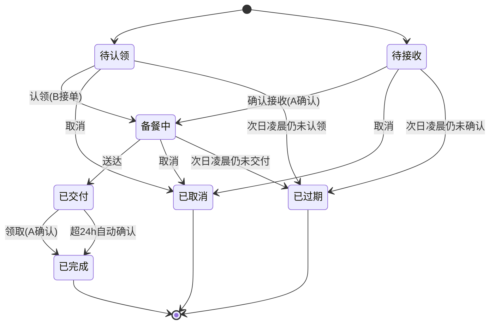

# 情侣带饭点餐小程序 · 产品需求文档（PRD）

> 版本：v0.11（已冻结）　|　日期：2026-10-27　|　状态：需求评审通过，可据此开发

---

## 1. 产品概述

### 1.1 定位
情侣之间"约今天吃啥、谁带饭"的**私密协作小程序**。非外卖、非账本、非严肃 AA。

### 1.2 一句话价值
**不是外卖，是"我记得你爱吃什么，并且愿意为你带饭"的专属记录仪。**

### 1.3 目标用户
- 处于稳定亲密关系的情侣（固定 2 人）。
- 至少有一方有"带饭 / 做饭给对方"的行为习惯（上班族、学生情侣居多）。
- 核心痛点：每天"今天谁带 / 带啥"协商成本高；偏好靠口头重复；带饭行为没有情感留存。

### 1.4 与替代品的本质差异

| 维度 | 我们 | 外卖平台 | 情侣 / 记账 App |
|---|---|---|---|
| 关系 | 固定 2 人、私密 | 陌生商家 | 通用多人 |
| 核心 | 约定 + 偏好记忆 + 情感数据 | 交易 / 配送 | 钱 / 任务 |
| 温度 | 便签 / 仪式感 / 年报 | 无 | 弱 |
| 货币 | 虚拟爱心值（不碰钱） | 真实支付 | 真实或虚拟账 |

---

## 2. 已确认的核心决策

| 项 | 决策 |
|---|---|
| 产品形态 | 纯点餐约定（约谁带、带啥），**无严肃饭债互欠** |
| 货币 | 纯虚拟记账：轻量爱心值，正向激励，不碰真实钱，不做欠债 |
| 后端 | 自建 **Spring Boot 3.4 + MyBatis-Plus + MySQL 8**（沿用备课系统栈） |
| 前端 | **uni-app（Vue3 + Vite + TypeScript）**，编译目标仅微信小程序 |
| MVP 推送 | 系统内红点 / 角标；微信订阅消息放二期 |
| 菜品图片 | 菜单库仍**纯文字**起步（省存储）；**打卡照片是 MVP 功能**，两者分开看（见 §5.7） |
| 打卡点评 | **MVP 做**：交付后吃饭时拍照打卡 + 三档评价 + 点评，沉淀成"饭桌相册"（2026-10-27 新增） |
| 时段 | MVP 仅午饭；午 + 晚放二期 |
| 场景 | **仅情侣工作日（周一~周五）带饭**；周末不自动排班，需要可手动发起 |
| 明确不做 | **不做代投喂 / 代买 / 外卖**，仅限情侣亲手带饭（2026-10-27 拍板） |

---

## 3. 突出点（差异化卖点）

| # | 突出点 | 我们怎么做 | 对比对象 | 为什么是壁垒 |
|---|---|---|---|---|
| **A** | 被记住的私密偏好库 | 忌口 / 爱吃自动沉淀，点餐时**主动拦截**"对方不吃这个" | 外卖每次从头选 | 情感价值：被记住；越用越懂对方 |
| **B** | 投喂养成的情感数据 | 爱心值、连续投喂、在一起吃饭天数、**年度带饭年报** | 冷冰冰订单 / 账单 | 把日常变成可回看的甜蜜记录，非账本 |
| **C** | 线下交付仪式感 | "已放公司门口柜 B12" + **便签留言**"留了汤" | 陌生人送达无温度 | 专属感：我给你送到楼下，不是快递 |
| **D** | 协商式"今天谁带" | 轮流制 / 小程序内**石头剪刀布** / 协商 | 各点各的，无机制 | 把情侣真实扯皮变成有趣机制 |
| **E** | 情感化表达替代交易语言 | "投喂""突然想吃你做的""想你" | "下单 / 支付 / 配送" | 语言即调性，区隔工具感 |
| **F** | 看得见的日常（饭桌相册） | 吃的时候**拍照打卡 + 三档点评**，自动串成时间线相册 | 外卖只有一张封面图 | 一年后能翻回"那天你给我带的红烧肉"——留存全靠这个 |

---

## 4. 信息架构

### 4.1 底部 Tab
```
Tab1 今日约定（首页）   Tab2 菜单库   Tab3 消息   （我的 / 设置入口在右上）
```

### 4.2 页面清单

| 页面 | 归属 | 说明 |
|---|---|---|
| 登录页 | 账户 | 微信授权登录 |
| 配对页 | 账户 | 未绑定时，生成 / 输入邀请码 |
| 关系主页 | Tab4「我的」 | 双人头像、称呼、**在一起 N 天 + 一起吃饭 N 天**、累计爱心值（卡片在页面顶部） |
| 今日约定页 | Tab1 | 今日约定卡片 + 发起入口 |
| 发起约定页 | Tab1 | 两种角色表单（点餐 / 主动带） |
| 约定详情页 | Tab1 | 状态推进、改派、取消、便签、打卡入口 |
| 菜单库页 | Tab2 | 菜品列表、筛选、新增 |
| 消息中心 | Tab3 | 通知列表、红点 |
| 我的页 | Tab4 | 关系卡片 + 周历 / 月报 / 相册 / 历史 / 设置入口 |
| 饭桌相册页 | 我的 | 打卡照片时间线（★F），按月分组 |
| 历史页 | 我的 | 约定历史、月度轻报告、年度回顾 |
| 周历视图 | 我的 | 一周谁带可视化 |
| 采购清单页 | Tab1 | 带饭前生成要买啥，到超市照买 |
| 设置页 | 我的 | 头像 / 昵称 / 称呼 / 纪念日 / 主题 / 提醒 / 解绑 |

> 双人视角：同一约定，A（点餐方）与 B（带饭方）看到的按钮不同，详见 §12.4 权限矩阵。
> **独立页面共 13 个**（关系主页嵌在 Tab1 顶部，菜品编辑走弹层，均不计入页面数）。
> 原型中的 `report` 屏是月报的**视觉演示**，实现形态是「历史页内卡片 + 年报弹层」，不单独开页（见 `design/70-历史/前端.md`）。

**弹层清单（不属于独立页面，但都是独立交互单元）**

| 弹层 | 触发点 | 用途 |
|---|---|---|
| 菜单选择层 | 发起页菜品区 | 多选带回 + **忌口强提醒** |
| 菜品编辑层 | 菜单库 ＋ / 空态引导 | 新增菜品（含忌口四级） |
| 协商谁带层（二期） | 周历「协商谁带」 | 石头剪刀布 / 硬币 |
| 送达交付层 | 详情页「标记送达」 | 交付位置 + 便签 + 确认送达（★C 仪式感） |
| 便签留言层 | 详情页「写便签」 | 写便签、快捷模板、回复 |
| 取消原因层 | 详情页「取消」 | 选原因 + 说明不计爱心值 |
| 打卡层 | 详情页「打卡」 | 照片 1–2 张 + 三档评价 + 点评（★F） |
| 解绑确认层 | 设置「解绑情侣」 | 声明历史保留 |

> 视觉与交互基线：`docs/ui-prototype-cream.html`（温暖奶油风，18 屏 + 9 弹层，可直接点击体验；其中「协商谁带」弹层为二期预览）。

---

## 5. 功能需求详述

### 5.1 关系与账户
- **微信登录**：点"微信登录" → `uni.login` 拿 code → 后端换 openid → 建 / 查 user → 回 token；已登录跳过；token 过期静默刷新。
- **创建情侣（发起方）**：点"创建情侣" → 后端生成 6 位邀请码（24h 时效）→ 展示邀请码 + 二维码 → 状态"等待对方加入"。
- **加入情侣（加入方）**：输入邀请码 / 扫二维码 → 点"加入" → 双方绑定 → 双端提示进入关系主页。
- **专属称呼**：互设"宝宝 / 老板"，全站替换昵称。
- **自定义在一起纪念日**：独立于绑定日，驱动「在一起 N 天」、年报与周年倒计时。
- **绑定趣味问卷（初始化偏好）**："谁厨房担当？""谁更爱吃辣？"——一次填完，菜单库与口味画像直接有底。
- **情侣主题色 / 头像框**：轻量个性化。
- **解绑（二期）**：设置 → 解绑 → 二次确认 → 关系置失效；数据归属见 §10。

**边界**：邀请码过期可一键重生成；一方已绑定则阻止重复绑定（需先解绑）。

### 5.2 点餐约定（核心）　★含 A / C / D / E
- **点餐入口（A 想吃）**：Tab1 点"我想吃" → 发起页（角色=点餐方）→ 选 / 填菜品 → 选时段（MVP 仅午饭，默认工作日）→ 填备注（口味 / 时间 / 地点）→ 提交 → 生成约定 `orderer=A, status=待认领` → 推提醒给 B。
- **主动带入口（B 带）**：Tab1 点"我带饭" → 发起页（角色=带饭方）→ 选 / 填菜品 → 提交 → 生成约定 `carrier=B, status=待接收` → A 需"确认接收"后才转`备餐中`（防一方单方面决定）。
- **菜单选择**：发起页"从菜单选" → 弹层（常点 / 分类 / 最近三组）→ 单选或多项带回 → 选中对方忌口项红字拦截。
- **协商式"今天谁带"★D（二期）**：三种模式——轮流制（自动排班）、协商（小程序内抛硬币 / 石头剪刀布）、指定。解决"今天你带还是我带"。
- **情感化点餐文案★E**：模板"突然想吃你做的红烧肉""今天好累，想吃你带的饭" + 自由输入，替代冷冰冰下单。
- **认领（B 接 A 的餐）**：B 在 Tab1 看到 A 的待认领约定 → 点"我来带" → `carrier=B, status=备餐中`。A 不能认领自己的点餐。
- **状态推进（带饭人）**：备餐中 → 点"已做好 / 已买" → 点"已送达" → `status=已交付`（带到达时间）。可一步直达。
- **交付仪式感★C**：标记"已放门口柜 B12 / 已到楼下"，接收方"下楼领取"。MVP **纯文字**——交付照片放二期，避免和打卡照片抢同一条上传链路。
- **便签留言★C**：带饭人附"锅里留了汤，趁热喝"；接收方回"爱你❤"。
- **确认完成（接收方）**：A 收到"已交付"提醒 → 点"已领取" → `status=已完成` → **触发 carrier 爱心值 +1**。
- **不做代投喂**：仅限情侣亲手带饭，不支持下外卖 / 代买 / 第三方代送（2026-10-27 明确）。
- **多菜品 / 拼单**：一次约定可挂多个菜。
- **轻量履约评价**：**并入 §5.7 打卡的三档评价**（🔥 香 / 😋 好吃 / 😐 还差点意思），不再单独维护一套评价——同一个人对同一顿饭不该评两次。
- **改派**：详情页 carrier 点"改派" → 退回待认领（或指定对方）→ 仅 carrier 可操作。
- **改期（二期）**：详情页点"改到明天" → `plan_date+1`，状态不变。
- **取消**：任一方点"取消" → 填原因 → `status=已取消`，写 `cancel_log(谁 / 何时 / 原因)` → 不发爱心值；**已交付、已完成不可取消**（饭已送到，只能领取或等 24h 自动完成）。
- **采购清单（联动约定）★C**：带饭人认领后，基于约定菜品一键生成"要买啥"购物单（也可手填）；到超市逐项勾选"已买"；可提前一天备料。解决"带饭先买菜"的真实环节，最落地。
- **共同周历视图★D**：Tab1 内切换"今日 / 本周"，以周表展示每天谁带、带啥，一眼看清一周分工。

### 5.3 菜单库　★含 A
- **查看**：默认全量，区分归属（我 / 对方），可按分类（荤 / 素 / 汤 / 主食）和标记（常点★ / 忌口⚠）筛选，也可按「最近点过」排序。
- **"我记得你"自动沉淀★A**：每次点餐 / 完成自动归入对方偏好，忌口永久记住。
- **新增**：点"+" → 名称、分类、可选图片（二期）、标常点 / 忌口、选归属（我 / 对方）→ 保存。
- **忌口分级**：不吃（强提醒，仍可提交）/ 少吃（黄字提醒）/ 过敏（红字强提醒，仍可提交）。按 Q2 决策——不硬拦，仅提醒由人决定。
- **口味画像**：系统归纳"TA 这月 70% 点辣的" → 洞察卡。
- **菜谱笔记（二期）**：不只菜名，存做法"红烧肉要加冰糖"。
- **"想试试"种草清单（二期）**：未点过的，约下次。
- **双人共创**：双方都能加，归属清晰。
- **编辑 / 删除**：点编辑改；删除二次确认。
- **智能推荐（偏好出口）★A**：基于口味画像与历史，发起点餐时在菜单层顶部推"今天适合吃红烧肉（TA 本周 70% 点辣）"；把"被记住"从被动拦截升级为主动推荐。

### 5.4 爱心值（轻量正向，非欠债）　★含 B
- **俏皮命名**：投喂值 / 爱心币。
- **加分触发**：约定变`已完成` → 后端自动给 carrier `+1`（reason=带饭），按 `plan_id` 幂等。
- **累计展示**：关系主页显示总爱心值 + 各自贡献（如"你 23 / TA 19"）。
- **连续投喂（二期）★B**：连续 N 天，断签提示"昨天谁鸽了？"。
- **在一起吃饭天数★B**：累计一起吃饭的天数（口径 = 打卡去重天数，与关系卡「在一起 N 天」不同，后者按纪念日起算——未设纪念日则按绑定日）。
- **里程碑徽章（二期）**：初次投喂、满 10 / 50 / 100 顿、连续 7 天、专属厨师（某类菜带最多）。
- **不抵扣、不欠债**（区别于情感账本 App）。

### 5.5 消息与提醒
- **系统内通知（MVP）**：触发点——新约定（给带饭方）、被认领（给点餐方）、已交付（给点餐方）、已完成（给双方）、已打卡（给带饭方），共 5 类 + 每日提醒 1 类，`type` 枚举见 `design/50-通知/后端.md §1`。写入通知表 → Tab3 红点 → 点开跳约定详情。
- **温馨文案★E**："该投喂 TA 啦~""TA 说想你做的饭"。
- **到达带位置提醒**：已送达时推"在楼下，下来拿"。
- **每日提醒（站内）**：工作日 **11:00** 仍有「待认领」的约定 → 提醒带饭方「该投喂 TA 啦~」（`DailyRemindJob`，MVP 内）。
- **微信订阅消息（二期）**：前端 `requestSubscribeMessage` + 后端模板推送，覆盖上述通知。

### 5.6 历史与统计　★含 B
- **历史列表**：按时间倒序展示全部约定（已完成 / 取消都留痕）→ 筛选日 / 周 / 月 → 点开看详情。
- **"我们的带饭年报"★B**：年度回顾——今年谁带得多、最爱菜、连续最久纪录、爱心值总结。情感化数据产品。
- **月度轻报告★B**：年报的轻量版，每月初推送上月小结（谁带多、最爱菜、爱心值变化），频次更高、更常触发情感回流。
- **最爱菜品 TOP、平均每周几顿、连续天数纪录**（二期）；其中最爱菜**优先取打卡里评为「香！」的菜**，比次数更能反映真实偏爱。
- **打卡数据回流**：年报 / 月报的"一起吃了 N 天""打卡最多的一道菜"来自 §5.7 打卡记录；历史列表卡片在打卡后显示首张缩略图。

### 5.7 吃饭打卡（饭桌相册）　★含 F / B
带饭这件事的"最后一步"——饭吃到了，拍一张，说一句。把约定变成可回看的记录。

- **打卡时机**：约定 `已交付` 或 `已完成` 后，**吃饭时（当天 10:00 – 次日 02:00）**可打卡；超过次日 02:00 视为漏打，不再补（防"月底批量补打卡"刷数据）。
- **打卡人**：**只有接收方（吃饭的人）能打卡**，带饭方不能代打；一个约定**只能打一次**（`plan_id` 唯一）。
- **打卡内容**：
  - 照片 **1–2 张**（必填 ≥1，拍摄或相册选取，自动压缩：原图长边 1080 / ≤500KB，另存 320 长边缩略图供列表用）；
  - 三档评价（必填）：`🔥 香！` / `😋 好吃` / `😐 还差点意思`——**不用五星**，打分像考核，三档像说话；
  - 点评（选填，≤100 字）+ 3 个快捷短语「香！」「下次少辣」「想吃第二次」。
- **带饭方回应**：可在打卡卡片下回一句（≤50 字）或点个 ❤，这是双向的情感闭环，不是单向好评。
- **打卡后联动**：
  - 「一起吃饭天数」「本月打卡 N 天」由打卡记录统计（此前没有数据源，现在有了）；
  - 月度 / 年度报告新增"打卡最多的一道菜""这个月一起吃了 N 天"；
  - 带饭方收到通知「TA 打卡了：香！」，点开直达打卡卡片；
  - **不额外加爱心值**（爱心值仍只认"完成 +1"），避免为刷分而拍照打卡。
- **饭桌相册页★F**：双列照片流，按月分组；卡片显示照片、菜名、三档评价、点评、日期与打卡人；顶部统计"本月打卡 N 天 / 最爱菜"；空态「还没有饭桌记录，今天吃完拍一张吧」。
- **可编辑**：打卡后当天可改评价与点评（照片可换），**不支持删除**——删了这段记忆就断了，只能改；确需清除走设置里的"删除数据"（合规入口）。
- **照片存储**：MVP 存本机磁盘 + Nginx 静态映射（`/upload/yyyyMM/xxx.jpg`），**图片域名必须 HTTPS 且已备案**；二期可迁对象存储。

**边界**
- 未到打卡窗口（约定未交付）→ 详情页不显示「打卡」按钮，只有置灰提示「吃到饭再来记录呀」。
- 逾期未打卡 → 详情页显示「这顿没来得及记录」+ 可写一句纯文字备注（不计入相册统计）。
- 图片上传失败 → **单张重试**，不整单重来；文字内容不丢。
- 打卡内容同样过内容安全检测（见 §12.8），照片走**异步图片检测**（见 §13 P0-8）。

### 5.8 设置
称呼 / 纪念日 / 主题色 / 提醒开关 / 解绑 / 退出登录。

---

## 6. 核心业务流程与状态机

### 6.1 点餐约定状态机



- **待认领**：A 点餐，等 B 认领。
- **待接收**：B 主动带，等 A 确认接收。
- **待认领 / 待接收 / 备餐中可取消**：双方皆可，记 `cancel_log`，不发爱心值；**已交付起不可取消**。
- **已完成**：触发爱心值 +1（按 `plan_id` 幂等）。
- **已过期**：次日 02:30 仍未交付（待认领/待接收/备餐中） → 自动归档进历史，不发爱心值（规则见 §12.6）。
- **终态三个**：已完成 / 已取消 / 已过期，均不可再流转。

### 6.2 协商式"今天谁带"流程（★D，二期）

> 本期不实现，仅保留产品定义，见 §10 二期范围。
1. 进入"今天谁带" → 选模式：轮流 / 协商 / 指定。
2. 轮流：按历史自动排，本期轮到谁高亮。
3. 协商：小程序内抛硬币 / 石头剪刀布，结果双方同步。
4. 指定：任一方直接指定自己或对方。
5. 确定后，被指定方自动成为该日约定的 carrier（或发起主动带）。

### 6.3 爱心值加分时序（★B）
```
约定 status → 已完成  ──(后端钩子)──>  love_value 插入 delta=+1 (carrier, plan_id 去重)
                                       关系主页 / 统计 累加展示
```

### 6.4 打卡时序（★F）
```
约定 status ∈ {已交付, 已完成} 且处于打卡窗口
   └─ 接收方点「打卡」→ 选照片(1-3) → 传图拿 URL → 选评价 → 写点评 → 提交
        ├─ 写 meal_checkin (plan_id 唯一，重复提交直接拒绝)
        ├─ 通知带饭方「TA 打卡了：香！」
        ├─ 相册时间线插入一张卡
        └─ 统计口径更新：一起吃饭天数 +1、本月打卡 +1
   └─ 带饭方「回应」→ 更新 meal_checkin.reply（不新建记录）
注：打卡不写 love_value，爱心值仍只由「已完成」触发。
```

---

## 7. 数据模型（MySQL 8）

> 共 **12 张表**。字段、类型、默认值、索引、约束的唯一真相源是 `db/schema.sql`（可直接执行，`ENGINE`/`CHARSET` 齐全）。
> 本节只说明「为什么拆成这 12 张」与每张表归哪个模块，**不再重复 DDL**——同一结构写两处必然漂移。

**建模约定（对齐公司 SQL 规范）**

| 约定 | 内容 |
|---|---|
| 主键 | `id BIGINT NOT NULL`，**雪花 ID、禁自增**；用 **53bit** 版本，保证返给小程序后 JS `Number` 不丢精度 |
| 公共字段 | 固定三列：`id` + `create_time` + `update_time`（公司规范为四列，含 `row_update_time`；它与 `update_time` 定义完全相同，本项目无多系统同步场景，省去，见设计文档 D14） |
| 禁用字段 | `create_by` / `update_by` / `delete_flag` 一律不出现；软删用 `status` 枚举 |
| 布尔命名 | 一律 `_flag` / `_status` 后缀，**禁止 `is_` 开头** |
| 索引命名 | `uk_{表名}_{字段}` / `idx_{表名}_{字段}` |
| 脚本幂等 | 建表用 `CREATE TABLE IF NOT EXISTS` |
| 外键 | 不使用，一致性由应用层保证 |

**12 张表一览**

| # | 表 | 职责 | 字段设计在 |
|---|---|---|---|
| 1 | `user` | 微信身份，`openid` 唯一 | `10-关系绑定/后端.md` |
| 2 | `couple` | 情侣关系，`user_a < user_b` 规范化；解绑=status 0，复合=复活原记录 | `10-关系绑定/后端.md` |
| 3 | `couple_invite` | 6 位邀请码 / 24h / 一次性 / 限频 | `10-关系绑定/后端.md` |
| 4 | `meal_plan` | 约定主体，承载状态机、超时与交付字段 | `20-约定/后端.md` |
| 5 | `meal_plan_item` | 约定菜品**快照**（存菜名不存菜 id，菜单改名不污染历史） | `20-约定/后端.md` |
| 6 | `menu_item` | 菜单库与忌口四级，**唯一做软删**的表（口味画像要历史） | `30-菜单与偏好/后端.md` |
| 7 | `love_value` | 爱心值流水，按 `(plan_id,user_id)` 幂等 | `40-爱心值/后端.md` |
| 8 | `shopping_list` | 采购条目，按 `(plan_id,item_name)` 幂等 | `80-采购清单/后端.md` |
| 9 | `cancel_log` | 取消原因留痕，一个约定一条 | `20-约定/后端.md` |
| 10 | `notification` | 站内通知，按 `(plan_id,type,receiver)` 去重 | `50-通知/后端.md` |
| 11 | `meal_checkin` | 打卡主记录，一个约定一条 | `60-打卡/后端.md` |
| 12 | `meal_checkin_image` | 打卡图片与审核状态，按 `trace_id` 定位单张 | `60-打卡/后端.md` |


**索引与约束（关键，防并发错账）**

| 表 | 索引 / 约束 | 用途 |
|---|---|---|
| `love_value` | `UNIQUE KEY uk_love_value_plan_user (plan_id, user_id)` | **爱心值幂等**：并发点「领取」只 +1 |
| `meal_checkin` | `UNIQUE KEY uk_meal_checkin_plan (plan_id)` | **打卡幂等**：重复提交由数据库拒绝 |
| `cancel_log` | `UNIQUE KEY uk_cancel_log_plan (plan_id)` | 一个约定只记一次取消 |
| `notification` | `UNIQUE KEY uk_notification_plan_type_receiver (plan_id, type, receiver_id)` | 同约定同类型通知不重复发 |
| `shopping_list` | `UNIQUE KEY uk_shopping_list_plan_item (plan_id, item_name)` | 重复生成清单不产生重复条目 |
| `meal_checkin_image` | `UNIQUE KEY uk_meal_checkin_image_trace (trace_id)` | 审核回调按 `trace_id` 定位单张 |
| `couple` | `UNIQUE KEY uk_couple_pair (user_a, user_b)` + `CHECK (user_a < user_b)` | 一对一绑定，防重复配对 |
| `couple_invite` | `UNIQUE KEY uk_couple_invite_code (code)` + `idx_couple_invite_creator_time` | 邀请码唯一 / 限频统计 |
| `meal_plan` | `idx_meal_plan_couple_date` + `idx_meal_plan_status_delivered` + `idx_meal_plan_status_date` | 今日 / 周历查询 + 两个定时任务的扫描索引 |
| `meal_checkin` | `KEY idx_meal_checkin_couple_time (couple_id, create_time)` | 相册按时间倒序翻页 |
| `notification` | `KEY idx_notification_receiver_read (receiver_id, read_flag, create_time)` | 未读数统计 |
| `menu_item` | `KEY idx_menu_item_couple_status_category (couple_id, status, category)` | 菜单库筛选（`status=1` 排除已删） |
| 全部表 | `ENGINE=InnoDB DEFAULT CHARSET=utf8mb4` | 昵称 / 备注含 emoji 不乱码 |

---

## 8. 非功能需求

- **双人同步**：MVP 用"进页面拉取 + 下拉刷新 + 系统内通知"保证两端看到最新，不上 WebSocket。
- **幂等**：爱心值、状态流转按 `plan_id` + 状态机校验，防重复加值 / 越级跳转。
- **数据隔离**：仅情侣双方可见彼此数据，关系外不可达。
- **推送策略**：MVP 系统内红点 / 角标；二期接入微信订阅消息（需授权 + 后端模板）。
- **存储**：菜单库菜品仍纯文字；MVP 图片只有**两处**——**用户头像**（长边 256 / ≤100KB，上传即审核）与**打卡照片**（原图长边 1080 / ≤500KB + 320 缩略图 ≤60KB）；统一落本机磁盘 `/data/upload/` + Nginx 静态映射，图片域名须 HTTPS + 已备案；二期可迁对象存储。

---

## 9. 已确认规则（原 Open Questions）

| # | 问题 | 决策结论 |
|---|---|---|
| Q1 | 解绑后数据归属？ | **已确认**：逻辑删除 couple，各自记录保留（双方本地历史仍可看） |
| Q2 | 忌口是否强制拦截？ | **已确认**：不硬拦，仅提醒可继续（不吃/过敏弹强提醒，仍可由人提交） |
| Q3 | MVP 时段范围？ | **已确认**：MVP 仅午饭，晚 / 加餐二期 |
| Q4 | 代投喂是否计爱心？ | **已取消**：不做代投喂，仅限情侣亲手带饭（不涉及外卖） |
| Q5 | 超时约定怎么处理？ | **已确认（2026-10-27）**：11:00 未认领催一次；已交付超 24h 未领取自动完成并照发爱心值；次日 02:30 仍未交付转已过期归档；工作日 18:00 后不可发起当日约定 |
| Q6 | 打卡规则（谁打 / 必须带图吗 / 怎么评 / 加不加爱心）？ | **已确认（2026-10-27）**：仅**接收方**可打卡、一个约定一次；**照片必填 1–2 张**；用**三档评价**（香 / 好吃 / 还差点意思）不用五星；**不额外加爱心值**；打卡窗口为交付后当天 10:00 – 次日 02:00 |

---

## 10. MVP 范围 vs 二期

| 模块 | MVP | 二期 |
|---|---|---|
| 关系 | 登录 / 配对 / 头像昵称 / 关系主页 / 设置（称呼·纪念日·主题色·提醒开关）/ 解绑 / 注销 | 头像框 / 更多主题皮肤 |
| 约定 | 点餐 / 主动带 / 认领 / 状态机 / 取消 / 便签 / 送达位置 / 超时自动归档 | 改期 |
| 菜单库 | 增删改查 / 常点 / 忌口拦截 / **口味画像** / **智能推荐** / 最近点过 | 图片 / 菜谱笔记 / 种草清单 |
| 爱心值 | 完成 +1 / 累计展示 / 在一起天数 | 连续投喂 / 徽章 |
| 消息 | 系统内通知 + 红点 + **每日提醒（11:00 未认领，站内）** | 微信订阅消息 |
| 历史 | 历史列表 / 月度轻报告 / 年度带饭年报 | — |
| 打卡相册(新增) | 拍照打卡（1–2 张）/ 三档评价 / 点评 / 带饭方回应 / 饭桌相册页 / 本机磁盘存储（原图 + 缩略图两档） | 相册分享海报 / 按菜聚合 / 对象存储 |
| 丰富功能(新增) | 采购清单 / 共同周历 / 智能推荐 | 协商式谁带（石头剪刀布） |

---

## 11. 技术栈与里程碑建议

**技术栈**
- 前端：uni-app（Vue3 + Vite + TypeScript），编译目标仅微信小程序
- 后端：Spring Boot 3.4 + MyBatis-Plus + MySQL 8
- 部署：自建（你已有 MySQL 8 环境）

**里程碑**

| 阶段 | 内容 | 强化突出点 |
|---|---|---|
| M0 | 骨架：建库建表 / 登录 / 鉴权 / 统一返回 | — |
| M1 | 关系与账户：邀请码 / 配对 / 解绑 / 注销 / 设置 | — |
| M2 | 约定闭环：点餐 / 认领 / 状态机 / 送达 / 完成 / 取消 | C |
| M3 | 菜单库 + 忌口拦截 + 口味画像 + 推荐 | A |
| M4 | 爱心值 + 消息中心（站内通知 / 红点） | B |
| M5 | 采购清单 + 共同周历 + 历史（月报 / 年报） | A C D B |
| M5.5 | 吃饭打卡 + 饭桌相册（上传链路 + 内容安全检测） | F |
| M6 | 四个定时任务（过期归档 / 24h 自动完成 / 邀请码失效 / 每日提醒，`@Scheduled`） | — |
| M7 | 真机回归 + 提审上线 | — |

> 任务拆解见 `openspec/changes/bootstrap-mvp/tasks.md`（9 个任务组，与上表一一对应）；里程碑细节见 `docs/开发前准备与详细设计.md §8`。
> **二期**：订阅消息推送 / 菜单库图片 / 协商式石头剪刀布 / 改期 / 相册分享海报。

---

## 12. 交互规范（Interaction Spec）

> 本章是**可直接对照开发**的交互契约。原型 `docs/ui-prototype-cream.html` 已按此实现，冲突时以本章为准。

### 12.1 反馈层级（什么场景用哪种）

| 层级 | 形态 | 用于 | 时长 / 去处 |
|---|---|---|---|
| **L1 toast** | 屏幕中央半透明浮层，不阻塞操作 | 操作成功、轻失败 | 1.5–2s 自动消失 |
| **L2 内联校验** | 字段下方红字 | 表单错误 | 常驻到修正 |
| **L3 确认弹层** | 底部 sheet，需手动点 | 破坏性 / 不可逆操作 | 手动关闭 |
| **L4 空态卡片** | 图标 + 主文案 + 引导按钮 | 无数据 | 常驻 |
| **L5 骨架屏** | 灰块 shimmer | 首屏 / 列表加载 | 到数据返回 |

**硬规则**
- 同一时刻只允许存在 **1 个 L3** 弹层；
- L1 不堆叠超过 2 条，后到的**替换**先到的（不排队）；
- 成功类操作**不弹 L3**，直接 L1 + 界面状态变化（例：送达后直接变状态，不弹"已送达"对话框）。

### 12.2 加载 / 刷新 / 错误

- 首屏请求 >300ms 才显示骨架屏（避免闪一下），>8s 转错误态。
- 列表统一**下拉刷新**；历史页每页 20 条，**上拉加载更多**。
- 提交类按钮：点击后**立即禁用 + loading**，200ms 内的重复点击直接丢弃（防双击重复建单）。
- 错误分三级处理：

| 类型 | 处理 |
|---|---|
| 网络错误（超时 / 断网） | 全屏错误态「网络开小差了」+ 重新加载按钮 |
| 业务错误（状态已变更、无权操作） | L1 toast 说明原因 + 自动刷新当前页 |
| 登录失效（token 过期） | 静默重登；失败才跳登录页 |

### 12.3 表单校验规则

| 字段 | 规则 | 提示文案 |
|---|---|---|
| 菜品（发起约定） | 至少 1 道，最多 10 道 | 先选一道想吃的吧～ |
| 备注 | ≤100 字 | 实时计数，超限标红 |
| 便签 | ≤80 字 | 同上 |
| 菜名（菜单库） | ≤20 字，同一 couple 内不可重名 | 菜单库里已经有这道菜了 |
| 昵称 / 称呼 | 2–12 字 | 起个 2–12 字的称呼吧 |
| 邀请码 | 6 位纯数字 | 邀请码是 6 位数字哦 |
| 取消原因 | 选择原因必填，自由填写 ≤100 字 | 告诉 TA 为什么取消吧 |
| 打卡照片 | 1–2 张，单张 ≤500KB，仅 jpg / png / webp | 至少拍一张呀 |
| 打卡评价 | 三档必选其一 | 说说今天味道怎么样 |
| 打卡点评 | ≤100 字（选填） | 实时计数，超限标红 |
| 带饭方回应 | ≤50 字 | 同上 |

**校验时机**：失焦即时校验（L2）+ 提交时全量校验并**滚动定位到首个错误字段**。

### 12.4 双视角按钮权限矩阵（★核心，防错操作）

同一约定，两个角色看到的按钮不同。**后端必须二次校验**，不能只靠前端隐藏。

| 约定状态 | 点餐方（接收方）可见 | 带饭方可见 | 不可见原因 |
|---|---|---|---|
| 待认领 | 取消 | **我来带** | 点餐方不能认领自己发的约定 |
| 待接收 | **确认接收**、婉拒 | 取消 | 未确认前带饭方不得推进状态 |
| 备餐中 | 取消（必填原因） | 写便签、改派、**标记送达**、取消（必填原因） | 带饭方不出现"领取"按钮 |
| 已交付 | **已领取**、**打卡** | 查看（等 TA 打卡） | 饭已送到，双方都无「取消」 |
| 已完成 | **打卡 / 改打卡**、回应 | 回应 | 终态，无状态操作 |
| 已取消 / 已过期 | 只读（**不可打卡**） | 只读 | 不可再流转 |

### 12.5 红点与已读

- 未读数 = `notification` 中 `receiver_id = 我 AND read_flag = 0`。
- **进入消息列表即全部已读**（不要求逐条点开），Tab 角标同步清零。
- 角标：`>99` 显示 **99+**，`=0` **隐藏**（不显示 0）。
- 已完成 / 已取消的通知**保留在列表**，只是不再计未读。
- 同一条通知重复触发（如反复刷新）按 `plan_id + type` 去重，不重复写入。

### 12.6 超时与自动流转

> **2026-10-27 已拍板**，四个时点确认执行。单体项目用 **Spring `@Scheduled` 单机定时任务**即可，不引入 xxl-job / MQ。

| 时点 | 动作 |
|---|---|
| 待认领 · 当日 11:00 仍未认领 | 给带饭方推一次提醒「今天的饭还没人带哦」 |
| 已交付 · 超 24h 未确认领取 | **自动转已完成**，爱心值照给（防一方故意不点卡住） |
| 次日 02:30 仍未交付（待认领/待接收/备餐中） | 转**已过期**，归档进历史 |
| 工作日 18:00 后 | 不允许再发起"当日"约定，只能约明天 |

### 12.7 弱网与草稿

- 发起页输入内容**本地暂存**（切后台 / 退出不丢）。
- 提交失败：保留全部内容 + L1「发送失败，点此重试」。
- 打卡图片上传：**单张失败可单独重试**，不整单重来；已传成功的图不重复上传，文字内容不丢（MVP 即需处理）。

### 12.8 内容安全

- 备注 / 便签 / 点评 / 自由填写的菜名走后端**敏感词过滤**，命中 → L1「换个说法吧～」并保留输入。
- **打卡照片**走后端**异步图片检测**（`mediaCheckAsync`）：提交后先进"审核中"，通过即展示、不通过置「已屏蔽」并允许重传；检测期间本人可见、对方看不到，避免等待阻塞。
- 前端 `maxlength` + 实时字数计数，不让人写完才发现超长。

### 12.9 二次确认清单（必须 L3 弹层）

| 操作 | 弹层必须说明 |
|---|---|
| 取消约定 | 填原因；提示"取消后本次不计爱心值" |
| 解绑情侣 | 提示"历史记录会保留，仍可在历史里回看" |
| 删除菜品 | 提示"删除后不影响已完成的约定" |
| 退出登录 | 轻提示即可（无需 L3） |

### 12.10 空态规范

四类空态，统一结构 = 图标 + 主文案 + 引导句 + 主按钮：

| 场景 | 主文案 | 引导 | 按钮 |
|---|---|---|---|
| 今日无约定 | 今天还没有约定 | 发一条「我想吃」，让 TA 来带饭吧 | 我想吃 |
| 菜单库为空 | 菜单库还是空的 | 把彼此爱吃的、不吃记下来 | 添加第一道菜 |
| 消息为空 | 暂无消息 | 约定有动静时会在这里提醒你 | —（无按钮） |
| 历史为空 | 还没有历史记录 | 完成一次带饭，就会留下甜蜜记录 | — |

### 12.11 文案调性（突出点 E 的落地约束）

- **只用**：投喂 / 带饭 / 想吃 / 留了汤 / 一起吃饭；
- **禁用**：下单 / 支付 / 配送 / 订单 / 客户；
- 报错也软：「网络开小差了」而不是「请求失败」；「TA 已经把饭带走了」而不是「状态冲突」；
- 按钮用第一人称动词：「我来带」「我想吃」。

---

## 13. 风险与合规清单（Risk & Compliance）

> 上线前逐条销项。**P0 不做会卡审核或直接翻车**，P1 不做会出 bug 或差评。

### P0 · 卡审核 / 数据红线

| # | 风险 | 后果 | 落点 |
|---|---|---|---|
| 1 | 隐私协议未弹窗即收集信息 | 微信审核**必驳回** | 首次启动弹协议，未同意不调用登录 |
| 2 | 服务类目误选「餐饮 - 外卖」 | 被要求《食品经营许可证》 | 选「工具 - 效率」或「生活服务」，上线前在后台核实类目资质 |
| 3 | 无账号注销 / 数据删除入口 | 违个保法，用户投诉 | 设置页加「注销账号」，真删 `user` 相关数据（逻辑删除≠删除权） |
| 4 | 仍用 `getUserProfile` 拿头像昵称 | 接口已废弃，拿不到 | 改 `button open-type="chooseAvatar"` + `input type="nickname"` |
| 5 | 只靠前端隐藏按钮做权限 | 改 `plan_id` 即可操作他人约定（IDOR） | 每个接口校验 `plan.couple_id == 当前用户 couple_id` |
| 6 | 建表未指定字符集 | 昵称 / 备注含 emoji 直接报错 | 建库建表统一 `utf8mb4` / `utf8mb4_0900_ai_ci` |
| 7 | 6 位邀请码可穷举 | 陌生人可加入他人情侣关系 | 同用户每小时限 5 次 + 一次性 + 绑定成功即失效 |
| 8 | **UGC 图片未接内容安全检测** | 有用户上传图片却不检测，**审核必驳回**，违规图还带平台风险 | 接 `security.mediaCheckAsync`（图片异步检测）+ `security.msgSecCheck`（点评文本）；未通过的图**不展示**，置「审核中 / 已屏蔽」，允许用户重传 |

### P1 · 出 bug / 差评

| # | 风险 | 落点 |
|---|---|---|
| 9 | 空态 / 加载 / 错误态缺失 | 已按 §12.1 / §12.2 / §12.10 补齐，原型已覆盖 |
| 10 | 过期约定无归宿 | 按 §12.6 自动转「已过期」并归档 |
| 11 | 红点不清零 / 反复提醒 | 按 §12.5 进列表即已读 + 按 `plan_id+type` 去重 |
| 12 | 弱网提交丢内容 | 按 §12.7 本地草稿 + 失败重试；图片单张重试 |
| 13 | 便签 / 点评 / 自由填含违规内容 | 按 §12.8 后端敏感词 + 微信文本检测双保险 |
| 14 | 并发点「领取」爱心值加两次 | `love_value` 加 `UNIQUE(plan_id, user_id)`（§7） |
| 15 | 一方故意不点「已领取」卡住流程 | 按 §12.6 超 24h 自动完成 |
| 16 | 打卡照片撑爆磁盘 | 只存压缩图（原图 ≤500KB / 长边 1080 + 缩略图 ≤60KB）、按 `yyyyMM` 分目录、总量超 5GB 告警 |

### P2 · 可后置

| # | 项 | 说明 |
|---|---|---|
| 17 | 换绑 / 重新配对流程 | **已定案（设计 D6）**：解绑后再绑同一人走「复活原 `couple` 记录」，历史天然连续，不需要合并逻辑；换人与新人绑定时旧关系记录保留但新关系看不到 |
| 18 | 数据备份 | 恋爱记录 + 照片无价，MySQL 每日备份 + `upload/` 目录同步备份，保留 30 天 |
| 19 | 对比度复核 | 次要文字 `#8C7B6B` 在奶油底上接近 4.5:1，需实测，不足则加深 |
| 20 | 定时任务可靠性 | 单机 `@Scheduled` 有漏跑风险，加日志 + 手动补跑入口即可，不引中间件 |
| 21 | 图片 CDN / 对象存储 | 单机磁盘只适合 2 人使用；若日后开放多对情侣，需迁 OSS |

---

## 14. 配套文档（产品之外的真相源）

| 文档 | 管什么 |
|---|---|
| `开发前准备与详细设计.md` | 开发前准备清单（账号 / 域名 HTTPS / 库表 / 脚手架 / 合规）、技术架构与鉴权、**接口路径总表（索引）**、数据字典、各模块异常与边界、测试策略、上线审核、里程碑 |
| `部署与运维.md` | 服务器规格与费用、MySQL 参数、systemd、Nginx、日志轮转、备份与恢复、上线检查清单、常见故障对照 |
| `design/README.md` | **设计文档导航**：按需求拆 9 个目录，每目录内 `后端.md`（表 / 接口契约 / 实现 / Job）+ `前端.md`（页面 / 交互 / 状态）。先读它，再按任务查表 |
| `db/schema.sql` | **表结构与索引唯一真相源**（12 张表，可直接执行）；本文 §7 只列表清单与模块归属 |
| `openspec/changes/bootstrap-mvp/` | 规格与验收标准：proposal / 9 个 capability specs / design / tasks |

> 本文档为产品基线；技术细节按上表各取所需，**不要凭本文猜实现**。

---

*本文档由需求讨论沉淀，后续以本文件为开发对照基线。*
